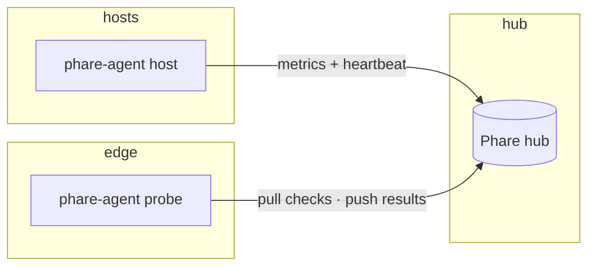

<p align="center">
  
</p>

<p align="center">
  <strong>Your lighthouse in the noise.</strong><br />
  Self-hosted operations center — uptime, host metrics, incidents, and a wallboard your team can trust.
</p>

<p align="center">
  <a href="LICENSE">Elastic License 2.0</a>
  · <a href="https://github.com/mchev/phare/releases">Releases</a>
  · <a href="docs/index.md">Documentation</a>
  · <a href="CONTRIBUTING.md">Contributing</a>
  · <a href="https://github.com/sponsors/mchev">Sponsor</a>
</p>

<p align="center">
  <a href="docs/media/screenshots/02-dashboard.png">
    
  </a>
</p>

<p align="center">
  <sub>Demo dataset · <a href="docs/index.md#aperçu">more screenshots</a></sub>
</p>

---

## Quick start

**Hub (local, ~5 minutes)**

```bash
git clone https://github.com/mchev/phare.git
cd phare
composer run setup
composer run dev
```

Open the URL in your browser → follow the **setup wizard** at `/setup` (database, admin, public hub URL).

**First Linux server (one line)**

In the UI: **Add a monitor** → **Server** → copy the command, then on the server:

```bash
curl -fsSL https://your-hub.example.com/install/<token> | sudo sh
```

The agent downloads from the [official GitHub release](https://github.com/mchev/phare/releases) matching your hub version, enrolls, and starts (systemd when available).

**Production hub (Forge / VPS)**  
`composer install --no-dev`, `npm ci && npm run build`, `php artisan migrate --force`, queue worker + scheduler, PostgreSQL + Redis → [docs/deploy/hub.md](docs/deploy/hub.md)

Non-interactive install: `php artisan phare:install` → [docs/user/installation.md](docs/user/installation.md)

---

## What you get

|                        |                                                                                 |
| ---------------------- | ------------------------------------------------------------------------------- |
| **Sites & services**   | HTTP, TCP, DNS, ICMP (via probes), SSL/domain renewals, smart website detection |
| **Servers**            | Push-only **Go agent** — CPU, RAM, disk, load; no inbound ports                 |
| **Sondes**             | Same `phare-agent` as an external **probe** for an outside-in view              |
| **Incidents & alerts** | Up/down truth, acknowledgements, email and notification adapters                |
| **Wallboard**          | Read-only NOC view for a TV or kiosk                                            |
| **Status pages**       | Public availability pages per client                                            |
| **Vault & renewals**   | Encrypted secrets (self-hosted) and RDAP/SSL renewal reminders                  |

One Laravel hub (Inertia + Vue). Agents talk **outbound only**. Database design favours rollups and events — not an endless heartbeat table.

Alternatives you might know: Uptime Kuma, Netdata, Better Stack — **Phare** bundles checks, light metrics, incidents, and wallboard without shipping telemetry to a vendor.

---

## How it fits together



- **Hub:** Laravel 13, PostgreSQL (recommended), Redis, [`phare-agent`](agent/README.md) enroll via `/api/v1`.
- **Monitored servers:** Linux amd64/arm64 today ([agent platforms](agent/README.md)).
- **API:** [docs/api.md](docs/api.md) · [OpenAPI](docs/openapi.yaml)

---

## Requirements

| Layer         | Minimum                                       |
| ------------- | --------------------------------------------- |
| Hub           | PHP 8.3+, Composer, Node (build assets)       |
| Hub (prod)    | PostgreSQL, Redis, `queue:work` + scheduler   |
| Agent / probe | Linux, HTTPS to hub + GitHub (binary release) |

---

## Updates & releases

| Role           | Action                                                                                               |
| -------------- | ---------------------------------------------------------------------------------------------------- |
| **Operator**   | `scripts/update.sh` then `phare:update` on the hub; re-run the server install line to refresh agents |
| **Maintainer** | Bump [`VERSION`](VERSION), `git tag vX.Y.Z && git push origin vX.Y.Z` → CI attaches agent binaries   |

Full checklist: **[docs/releases.md](docs/releases.md)**

---

## Documentation

| Start here                                                                   | Deep dive                                                                      |
| ---------------------------------------------------------------------------- | ------------------------------------------------------------------------------ |
| [docs/index.md](docs/index.md) — index                                       | [docs/guideline/SKILL.md](docs/guideline/SKILL.md) — product & tech            |
| [docs/user/installation.md](docs/user/installation.md) — first install       | [docs/guideline/reference.md](docs/guideline/reference.md) — schemas & storage |
| [docs/user/surveiller.md](docs/user/surveiller.md) — monitoring wizard       | [docs/deploy/hub.md](docs/deploy/hub.md) — production                          |
| [docs/user/hosts-agent.md](docs/user/hosts-agent.md) — agents                | [docs/migration-kuma.md](docs/migration-kuma.md) — import from Kuma            |
| [docs/user/sondes-wallboard.md](docs/user/sondes-wallboard.md) — probes & TV | [docs/security.md](docs/security.md) — hardening                               |
| [docs/roadmap.md](docs/roadmap.md)                                           | [agent/README.md](agent/README.md)                                             |

User guides are mostly in **French**; the UI defaults to **English**.

---

## Repository

```
app/Modules/     domain logic (Checks, Hosts, Incidents, …)
agent/           phare-agent (Go)
resources/js/    Inertia console
docs/            product, user, and deploy docs
```

Security: [SECURITY.md](SECURITY.md) · License: [Elastic License 2.0](LICENSE) — self-host freely; offering Phare as a **hosted service for others** is not permitted. Commercial hosted use: **martin@pegase.io**
