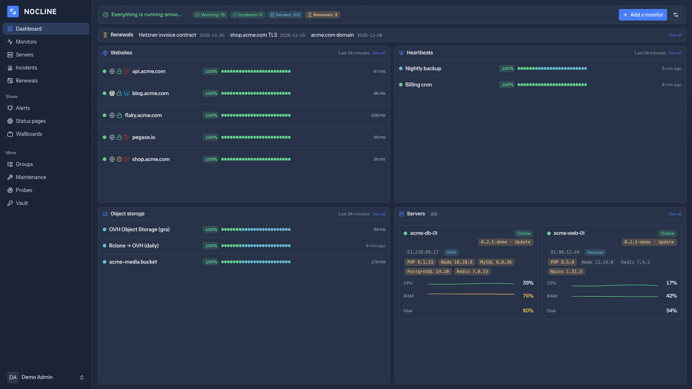

<p align="center">
  
</p>

<p align="center">
  <strong>Your lighthouse in the noise.</strong><br />
  Self-hosted operations center — uptime, host metrics, incidents, and a wallboard your team can trust.
</p>

<p align="center">
  <a href="LICENSE">Elastic License 2.0</a>
  · <a href="https://github.com/mchev/phare/releases">Releases</a>
  · <a href="docs/index.md">Documentation</a>
  · <a href="CONTRIBUTING.md">Contributing</a>
  · <a href="https://github.com/sponsors/mchev">Sponsor</a>
</p>

<p align="center">
  <a href="docs/media/screenshots/02-dashboard.png">
    
  </a>
</p>

<p align="center">
  <sub>Demo dataset · <a href="docs/index.md#aperçu">more screenshots</a></sub>
</p>

---

## Installation

Needs **PHP 8.3+**, **PostgreSQL** (recommended), **Redis**, and a **queue worker** + **scheduler** in production. Full checklist: [docs/deploy/hub.md](docs/deploy/hub.md).

### Linux server (VPS)

Web root → `public/`.

```bash
git clone https://github.com/mchev/phare.git
cd phare
composer install --no-dev --optimize-autoloader
npm ci && npm run build
cp .env.example .env
php artisan key:generate
```

Open `https://your-domain/setup` and finish the wizard (database, admin, public URL).

Then keep a worker and the scheduler running, for example:

```bash
php artisan queue:work --tries=3
php artisan schedule:work
```

(Use Supervisor or systemd in production — see [deploy/hub.md](docs/deploy/hub.md).)

Headless install instead of the wizard: `php artisan phare:install` — [installation.md](docs/user/installation.md).

### Laravel Forge

PHP **8.3** site, **PostgreSQL** + **Redis**. In the environment: `QUEUE_CONNECTION=redis`, `CACHE_STORE=redis`.

**Deploy script:**

```bash
cd $FORGE_SITE_PATH
git pull origin $FORGE_SITE_BRANCH
composer install --no-dev --no-interaction --prefer-dist --optimize-autoloader
npm ci && npm run build
php artisan migrate --force
php artisan queue:restart
```

**Daemons:** `php artisan queue:work --sleep=3 --tries=3` and the **scheduler** (Forge scheduler or `schedule:work`).

First visit: `https://your-domain/setup` (or `phare:install` once).

### Local try

```bash
git clone https://github.com/mchev/phare.git
cd phare
composer run setup
composer run dev
```

Open the URL shown in the terminal → `/setup` (SQLite is fine).

---

## Getting started

1. **Sign in** with the account you created in setup.
2. **Add a monitor** → *website*, *server*, or *something else* ([guide](docs/user/surveiller.md)). For a server, the app shows the install command when you need it.
3. **Alerts** — set up a channel when prompted ([alerts & incidents](docs/user/checks-incidents-alertes.md)).
4. **Wallboard** — optional TV link under *Wallboards* ([sondes & wallboard](docs/user/sondes-wallboard.md)).

User guides (mostly **French**): **[docs/user/README.md](docs/user/README.md)** · UI defaults to **English**.

---

## Features

| | |
| --- | --- |
| **Websites & services** | HTTP/TCP/DNS checks, SSL and domain renewals, optional probes for outside-in views |
| **Servers** | Lightweight **Go agent** — CPU, RAM, disk; metrics pushed to the hub |
| **Incidents** | Clear up/down state, acknowledgements, history |
| **Alerts** | Email and pluggable notification adapters |
| **Wallboard** | NOC view for a TV or kiosk |
| **Status pages** | Public pages per client or service |
| **Vault** | Encrypted secrets on your own server |

One console instead of juggling separate uptime, metrics, and TV tools — **your data stays on your infrastructure**.

Coming from **Uptime Kuma**? **[Import guide](docs/migration-kuma.md)**.

---

## Advanced

| Topic | Where to read |
| --- | --- |
| **Updates** | `scripts/update.sh` then `php artisan phare:update` — [releases](docs/releases.md) |
| **Probes** (ICMP, external checks) | [Sondes & wallboard](docs/user/sondes-wallboard.md) |
| **API & tokens** | [docs/api.md](docs/api.md) |
| **Security & hardening** | [docs/security.md](docs/security.md) · report: [SECURITY.md](SECURITY.md) |
| **Backups (DB + vault key)** | [docs/privacy.md](docs/privacy.md) |
| **Roadmap** | [docs/roadmap.md](docs/roadmap.md) |

---

## Developers

Architecture, modules, tests, and contribution workflow: **[CONTRIBUTING.md](CONTRIBUTING.md)** · technical index: **[docs/index.md](docs/index.md)** · agent binary: **[agent/README.md](agent/README.md)**.

---

## License

Phare is released under the **[Elastic License 2.0](LICENSE)**.

| You can | You cannot (without a separate agreement) |
| --- | --- |
| Self-host and use Phare for your own organisation | Offer Phare (or a substantially similar service) **as a hosted / managed product for third parties** |
| Modify the code for your own deployment | Use the Elastic License restrictions to bypass the hosted-service limitation |

**Commercial hosted or multi-tenant SaaS:** contact **martin@pegase.io**.