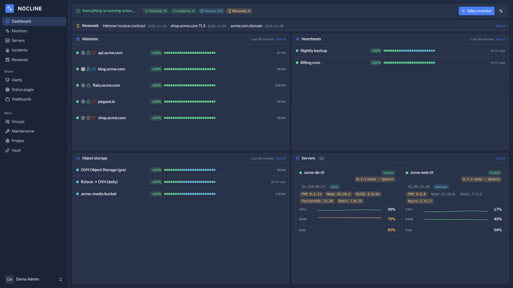

# Aperçu

Site généré avec [VitePress](https://vitepress.dev) et publié sur [GitHub Pages](https://mchev.github.io/nocline/).

Install rapide : voir le [README sur GitHub](https://github.com/mchev/nocline#installation). Contribution : [CONTRIBUTING.md](https://github.com/mchev/nocline/blob/main/CONTRIBUTING.md).

## Captures (jeu démo)

`php artisan nocline:demo:seed` puis `php artisan nocline:demo:simulate`.

|                    |                                                                                                                                                                            |
| ------------------ | -------------------------------------------------------------------------------------------------------------------------------------------------------------------------- |
| **Console**        |                                                                                                                   |
| **Monitors**       | [Liste groupée](../media/screenshots/03-monitors.png) · [Assistant](../media/screenshots/04-add-monitor-wizard.png) · [Site web](../media/screenshots/05-website-form.png) |
| **Serveurs & ops** | [Agents](../media/screenshots/06-servers.png) · [Incidents](../media/screenshots/08-incidents.png) · [Wallboard NOC](../media/screenshots/07-wallboard.png)                |
| **Setup**          | [Assistant d’installation](../media/screenshots/01-setup-welcome.png)                                                                                                      |

## Index technique

- **Agent Go** : [agent/README.md](https://github.com/mchev/nocline/blob/main/agent/README.md)
- **Modules Laravel** : [app/Modules/README.md](https://github.com/mchev/nocline/blob/main/app/Modules/README.md)
- **Package `nocline/laravel`** : [packages/nocline-laravel/README.md](https://github.com/mchev/nocline/blob/main/packages/nocline-laravel/README.md)
- **OpenAPI** : [openapi.yaml](https://github.com/mchev/nocline/blob/main/docs/openapi.yaml)
