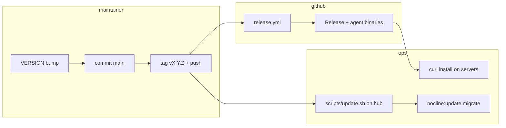

# Versions et releases

Nocline a **une version produit** (fichier [`VERSION`](https://github.com/mchev/nocline/blob/main/VERSION) à la racine du repo). Elle sert à :

- comparer le hub avec les releases GitHub (`nocline:update:check`) ;
- construire l’URL de téléchargement de **`nocline-agent`** (`vX.Y.Z` = contenu de `VERSION`).

Repo officiel des binaires agent : **`mchev/nocline`** (`NOCLINE_OFFICIAL_REPOSITORY`). Le hub peut suivre un fork pour les mises à jour via `NOCLINE_REPOSITORY`.

---

## Numérotation

| Élément                  | Format                                                   | Exemple               |
| ------------------------ | -------------------------------------------------------- | --------------------- |
| Fichier `VERSION`        | `X.Y.Z` (sans préfixe `v`)                               | `0.1.0`               |
| Tag git / release GitHub | `vX.Y.Z`                                                 | `v0.1.0`              |
| Assets agent             | `nocline-agent-linux-amd64`, `nocline-agent-linux-arm64` | sur la release du tag |

Le workflow release vérifie que `v$(cat VERSION)` == tag poussé.

---

## Publier une release (mainteneur)

### Checklist avant le tag

- [ ] Fonctionnalités mergées sur `main`, CI verte (`composer ci:check` en local).
- [ ] Migrations présentes si le schéma change.
- [ ] **`VERSION` incrémenté** et commité.
- [ ] Notes de version prêtes (le workflow peut générer des release notes GitHub).

### Commandes

```bash
# 1. VERSION déjà bumpé et commité sur main
git push origin main

# 2. Tag aligné sur VERSION
git tag v0.1.1
git push origin v0.1.1
```

### Ce que fait GitHub Actions

Workflow [`.github/workflows/release.yml`](https://github.com/mchev/nocline/blob/main/.github/workflows/release.yml), déclenché par le **push du tag** `v*` :

1. Checkout du tag.
2. Vérification `VERSION` ↔ tag.
3. Build Go : `nocline-agent-linux-amd64` et `arm64`.
4. Création ou **mise à jour** de la release GitHub avec ces fichiers joint.

**À ne pas faire** : créer une release vide dans l’UI GitHub (tag sans binaires) → les installs `curl | sh` répondent 404.

### Dépannage release sans assets

| Situation                                | Action                                                        |
| ---------------------------------------- | ------------------------------------------------------------- |
| Release créée à la main, pas de binaires | **Actions** → _release_ → **Run workflow** → saisir `vX.Y.Z`  |
| Secours hors CI                          | `scripts/publish-agent-assets.sh vX.Y.Z` (Go + `gh` en local) |

Vérification :

```bash
curl -fsSI "https://github.com/mchev/nocline/releases/download/v0.1.0/nocline-agent-linux-amd64" | head -3
```

---

## Mettre à jour un **hub** déjà en production

### Installation par `git clone` (VPS)

```bash
cd /chemin/vers/nocline
scripts/update.sh           # dernier tag v*
# ou version précise :
scripts/update.sh v0.1.1
```

Le script :

- refuse s’il reste des modifications locales non commitées ;
- `git fetch` + checkout du tag ;
- `composer install --no-dev`, `npm ci && npm run build` ;
- `php artisan nocline:update` (sauvegarde BDD si SQLite, maintenance, `migrate --force`, caches, `queue:restart`).

### Laravel Forge (deploy script typique)

Sans necessarily `scripts/update.sh` :

```bash
cd /home/forge/votre-site
git pull origin main   # ou checkout du tag vX.Y.Z
composer install --no-dev --optimize-autoloader --no-interaction
npm ci && npm run build
php artisan migrate --force
php artisan queue:restart
php artisan config:cache   # si vous utilisez la config cache
```

Après un tag, déployer **le commit/tag** qui contient le nouveau `VERSION`. Aucun Go sur le serveur hub.

### Bannière « mise à jour disponible »

- Commande planifiée : `nocline:update:check` (quotidien).
- Compare `VERSION` local au dernier tag GitHub (`NOCLINE_REPOSITORY`, souvent `mchev/nocline`).
- Désactiver les appels sortants : `NOCLINE_UPDATE_CHECK=false`.

---

## Mettre à jour les **agents** sur les serveurs

- L’URL de téléchargement est dérivée du **`VERSION` du hub** (pas de `latest` implicite côté installateur).
- Après upgrade du hub, **relancer** la commande d’installation depuis l’UI (_Generate a new command_ si le jeton a expiré).
- Les serveurs doivent atteindre **`github.com`** (HTTPS) et le hub (enrôlement).

L’install one-liner ne cible que **Linux amd64/arm64** (voir [agent/README.md](https://github.com/mchev/nocline/blob/main/agent/README.md)).

---

## Schéma récapitulatif



---

## Voir aussi

- [deploy/hub.md](deploy/hub.md) — prérequis prod, Forge, variables d’environnement
- [user/installation.md](user/installation.md) — premier install hub
- [user/hosts-agent.md](/fr/user/hosts-agent) — enrôlement serveur
- [CONTRIBUTING.md](https://github.com/mchev/nocline/blob/main/CONTRIBUTING.md) — releases (résumé mainteneur)
- [README.md](https://github.com/mchev/nocline/blob/main/README.md) — vue d’ensemble (anglais)
