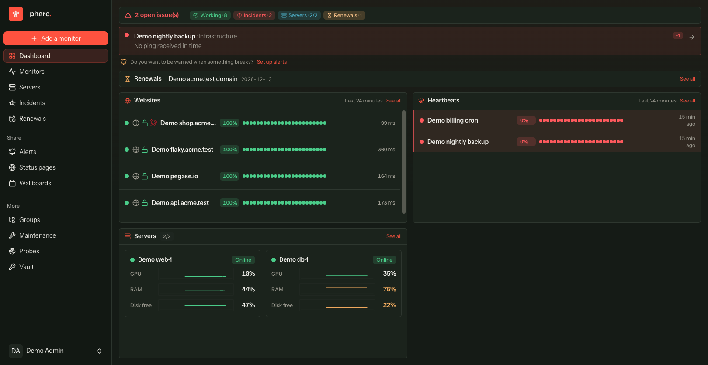

# Documentation Phare

## Aperçu

Captures UI (jeu démo : `php artisan phare:demo:seed` puis `phare:demo:simulate`). Fichiers dans [`media/screenshots/`](media/screenshots/).

| | |
| --- | --- |
| **Console** |  |
| **Monitors** | [Liste groupée](media/screenshots/03-monitors.png) · [Assistant](media/screenshots/04-add-monitor-wizard.png) · [Site web](media/screenshots/05-website-form.png) |
| **Serveurs & ops** | [Agents](media/screenshots/06-servers.png) · [Incidents](media/screenshots/08-incidents.png) · [Wallboard NOC](media/screenshots/07-wallboard.png) |
| **Setup** | [Assistant d’installation](media/screenshots/01-setup-welcome.png) |

## Produit

- **Guideline (git, source de vérité)** : [guideline/SKILL.md](guideline/SKILL.md)
- **Référence technique** : [guideline/reference.md](guideline/reference.md)
- **Copie Cursor (non versionnée par défaut)** : `/.cursor/skills/phare/`
- **Roadmap** : [roadmap.md](roadmap.md)
- **Documentation utilisateur** : [user/README.md](user/README.md)
- **Écrire un adapter de notification** : [contributing/notification-adapters.md](contributing/notification-adapters.md)
- **API REST v1 (tokens personnels, heartbeat)** : [api.md](api.md) · spec OpenAPI [openapi.yaml](openapi.yaml)
- **Traductions** : [user/traductions.md](user/traductions.md)
- **Maintenance planifiée et pages de statut** : [user/maintenance-statut.md](user/maintenance-statut.md)
- **RGPD self-hosted (coffre)** : [privacy.md](privacy.md)
- **Sécurité (coffre, jetons, durcissement, journal d'activité)** : [security.md](security.md) — signalement : [../SECURITY.md](../SECURITY.md)

## Code

- **Hub Laravel** : racine du repo (`app/`, `routes/`, `resources/js/`)
- **Agent / sonde** : [`../agent/README.md`](../agent/README.md)
- **Modules métier** : [`../app/Modules/README.md`](../app/Modules/README.md)
- **Package client Laravel `phare/laravel`** : [`../packages/phare-laravel/README.md`](../packages/phare-laravel/README.md)

- **Migration depuis Uptime Kuma** : [migration-kuma.md](migration-kuma.md)

## Déploiement

- [deploy/hub.md](deploy/hub.md) — Forge / VPS, Postgres, Redis, Horizon
- [releases.md](releases.md) — publier une version, mettre à jour hub et agents
